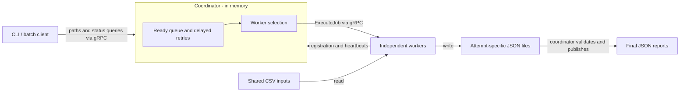

# Distributed Task Scheduler

A Python distributed task scheduler for batches of HTTP request logs stored as CSV
files. An in-memory coordinator assigns files to independent gRPC workers, limits
concurrent execution, and retries work after worker failures. The project focuses
on scheduling algorithms, concurrency safety, fault recovery, and performance analysis.

## Key features

- gRPC execution with First Available, Round Robin, and Least Loaded scheduling.
- Concurrent workers with configurable capacity and thread-safe reservations.
- Heartbeat-based failure detection and bounded retries with exponential backoff.
- Attempt IDs and atomic publication to protect results from stale executions.
- Streaming CSV statistics, Prometheus metrics, and repeatable benchmarks.
- pytest coverage and a GitHub Actions workflow for linting and tests.

## Architecture



The **client** submits input/output paths. The **coordinator** owns job state, the
ready queue, delayed retries, and worker selection. **Workers** read shared CSV
files and produce reports; only the coordinator publishes the accepted result.
One job processes one file. Files are shared through the filesystem, not sent over
gRPC. See [architecture and trade-offs](docs/architecture.md) for synchronization,
publication guarantees, complexity, and measurement details.

## Tech stack

Python 3.10+, gRPC and Protocol Buffers for communication, threading and
`concurrent.futures` for concurrency, and Prometheus client for monitoring.
pytest and Ruff provide verification; psutil and cProfile support measurements.
Docker Compose supplies an optional coordinator-and-three-workers environment.

## Quick start

Use a Python installation with venv/pip support. Run all terminals from the
repository root and activate the same environment in each. Create the environment
locally; do not copy `.venv` between operating systems. Process-based tests and
benchmarks use POSIX facilities; local verification was on Linux.

```sh
python3 -m venv .venv
. .venv/bin/activate
python -m pip install -e ".[dev]"
```

On Debian/Ubuntu, an `ensurepip` error means the matching Python venv package
is missing (for example, `python3.14-venv` for Python 3.14).

Generated protobuf bindings are committed, so the demo needs no generation step.
Stop any previous local servers or Compose services using ports 50051 and 8000.
Start the coordinator in one terminal and a worker in another:

```sh
# Terminal 1
python cli.py coordinator 50051 --metrics-port 8000
```

```sh
# Terminal 2
python cli.py worker localhost 50051 localhost 50052 --capacity 2
```

In another terminal, generate synthetic logs, submit them, wait for completion,
and inspect a result:

```sh
python -m examples.generate_demo_data --files 3 --rows 100
python -m examples.demo_client
python cli.py status localhost 50051 job-1
python -m json.tool demo_output/requests-1.json
```

On a fresh coordinator, `job-1` should be `COMPLETED`. Reports contain request
counts, successes (HTTP 200–399), client/server errors, average/maximum response
time, unique users, and requests per endpoint. The CSV header is:

```csv
timestamp,user_id,endpoint,status_code,response_time_ms
```

For a single job, use the included [sample](examples/sample.csv):

```sh
python cli.py submit localhost 50051 examples/sample.csv demo_output/sample.json
python cli.py metrics localhost 50051
```

`submit` prints the ID to query with `status`. After `COMPLETED`, the sample report is:

```json
{
  "totalRequests": 4,
  "successfulRequests": 2,
  "clientErrors": 1,
  "serverErrors": 1,
  "averageResponseTimeMs": 275.0,
  "maxResponseTimeMs": 500,
  "uniqueUsers": 3,
  "requestsByEndpoint": {"/api/orders": 1, "/api/products": 1, "/api/search": 2}
}
```

Stop servers with Ctrl-C.
Installation also provides `distributed-scheduler`, equivalent to `python cli.py`.
You can also run `python -m distributed_scheduler.cli`.
Docker Compose provides a three-worker demo; commands and shared-filesystem
requirements are in [the architecture guide](docs/architecture.md#docker-compose).

## Scheduling strategies

FIFO orders **ready jobs**, while the selected policy chooses **which worker**
receives each job. Assignment order does not imply completion order. Delayed
retries enter the ready-queue tail when eligible and never block ready jobs.

| Policy | Worker selection |
| --- | --- |
| First Available | Available worker with the smallest lexical address |
| Round Robin | Next available address in a cycle, skipping full workers |
| Least Loaded | Lowest `active_jobs / capacity`; address breaks ties |

The coordinator reserves capacity under its state lock; workers independently
enforce their limit with a bounded semaphore. Policies do not estimate job cost.
Configure `--scheduler`, `--capacity`, and `--max-retries`, or use `SCHEDULER`,
`WORKER_CAPACITY`, and `MAX_RETRIES`. Explicit flags take precedence.

## Fault tolerance

Workers send heartbeats every two seconds; the coordinator expires them after six
seconds, checked once per second. Transport failures also trigger reassignment.
Session IDs prevent old heartbeats from refreshing a replacement worker. An
expired worker must restart and register again.

Transient execution failures receive up to three retries by default (four total
attempts), with exponential backoff. Invalid input and publication errors fail
immediately. Each attempt writes a unique staged file; the coordinator validates
the current attempt, claims publication under its state lock, and atomically
replaces the final output before marking the job `COMPLETED`.

Retries use at-least-once execution semantics: an old attempt can continue after
reassignment. Execution is not exactly once, and exhausted retries can end in
`FAILED`. Stale responses cannot publish the final result. Filesystem publication
runs outside the state lock; it requires atomic replacement on the shared filesystem.

## Benchmarks

Workloads cover equal-sized files, variable-sized files, high load, and a controlled
worker crash. Experiments compare all three policies with 1, 2, and 4 workers.
Measurements include throughput, mean/p50/p95 latency, queue wait, assignments,
retries, CPU time, and sampled peak RSS.

Previously recorded local measurements: Linux x86-64, Python 3.14.4, 8 reported
logical CPUs, 20,000 base rows, two slots per worker, three trials per configuration.
The [recorded dataset](benchmarks/results/2026-10-10-local.json) contains 108 runs,
3,240 completed jobs, zero failed jobs, and 54 retries in injected-failure runs.
High-load scenario: 48 files of 20,000 rows, four workers, means across three trials:

| Policy | Batch time ± sample SD (s) | Throughput (jobs/s) | Mean latency (s) | p95 latency (s) | Queue wait (s) |
| --- | ---: | ---: | ---: | ---: | ---: |
| First Available | 0.8715 ± 0.1509 | 56.12 | 0.4635 | 0.7512 | 0.3277 |
| Round Robin | 0.7651 ± 0.0405 | 62.85 | 0.3974 | 0.6827 | 0.2781 |
| Least Loaded | 0.7924 ± 0.0116 | 60.59 | 0.4031 | 0.7069 | 0.2817 |

The p95 column averages per-run percentiles rather than pooling all jobs.
This table is not a universal ranking. With variable file sizes and four workers,
First Available averaged 1.2007 s, Round Robin 1.5076 s, and Least Loaded 1.4791 s.
Even one-worker controls varied. These local results do not establish cluster
scalability or a before/after improvement.

```sh
# Analyze the committed measurements
python -m benchmarks.analyze_benchmarks benchmarks/results/2026-10-10-local.json
# Small execution check; not a performance comparison
python -m benchmarks.benchmark --rows 1000 --repeats 1 --workers 1 --scenarios equal worker-failure
```

New output defaults to ignored `benchmarks/results/latest.json`. Full reproduction
and profiling commands are in [the measurement guide](docs/architecture.md#benchmarks-and-profiling).

## Testing

```sh
python -m grpc_tools.protoc -I . --python_out=. --grpc_python_out=. distributed_scheduler/distributed_jobs.proto
python -m ruff check .
python -m yapf --diff --recursive distributed_scheduler benchmarks examples tests cli.py
python -m pytest -q
```

Python code uses YAPF's `google` formatting profile, configured in
`pyproject.toml`. Run `make format` to apply it. Generated protobuf bindings
are excluded from formatting.

Tests cover CSV statistics, all selection policies, concurrent submissions,
capacity, heartbeats, retries, stale/duplicate results, atomic publication,
Prometheus export, and process failure/recovery. Use `-m 'not integration'` for the
fast suite or `-m integration` for separate-process tests. Tests require local TCP
ports and no external service. CI performs installation, generation, linting,
and tests on Python 3.13; a successful GitHub-hosted run is not yet verified.

Repository preparation verified editable installation in a clean Python 3.14
environment, protobuf generation, Ruff, all 46 tests, the local quick start, and
the small benchmark above.

## Limitations

- Coordinator state and history are in memory. Restart loses them; a single
  coordinator is a failure point, and accepted jobs/history are not bounded.
- Workers and coordinator need shared filesystem paths with coherent visibility
  and atomic same-directory replacement. Each job needs a distinct output path.
- Heartbeats detect lost workers, not hung computations that keep heartbeating.
  There is no execution deadline or queue timeout.
- Exact unique-user and endpoint counts retain memory proportional to cardinality.
- Authentication, TLS, durable recovery, and high availability are outside scope.
  This is a learning and portfolio project for trusted environments.
- A manual Docker demo produced the expected 1,000-row JSON report. Automated
  container lifecycle and HTTP metrics checks remain unverified because the
  verification environment cannot access the Docker socket. Recorded benchmark
  results were checked, not rerun in full during repository preparation.

Licensed under the [MIT License](LICENSE).

## Repository layout

- `distributed_scheduler/`: application, protobuf schema, and generated bindings.
- `benchmarks/`: performance benchmarks, profiling, analysis, and recorded results.
- `examples/`: demo scripts and sample CSV input.
- `tests/`: unit and integration tests.
- `docs/`: architecture and engineering decisions.

Configuration and the `cli.py` application entry point stay in the project root.
Run benchmarks and demos with `python -m` using their package paths.
